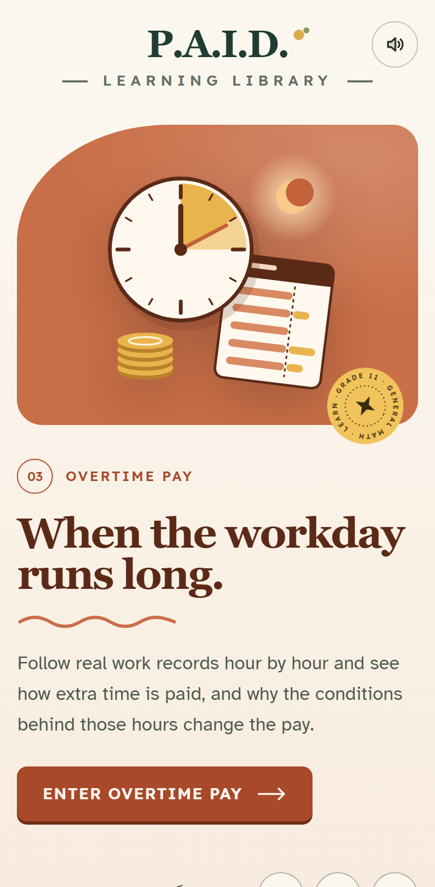
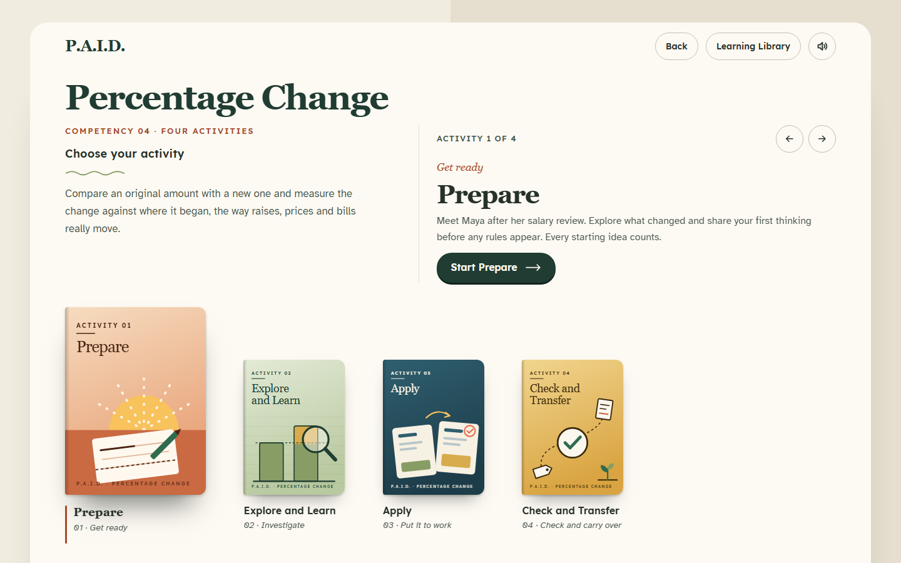
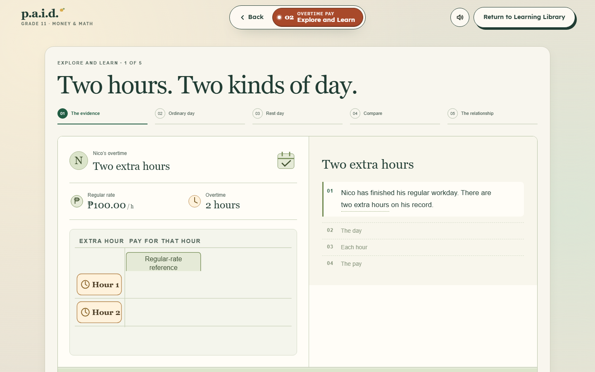
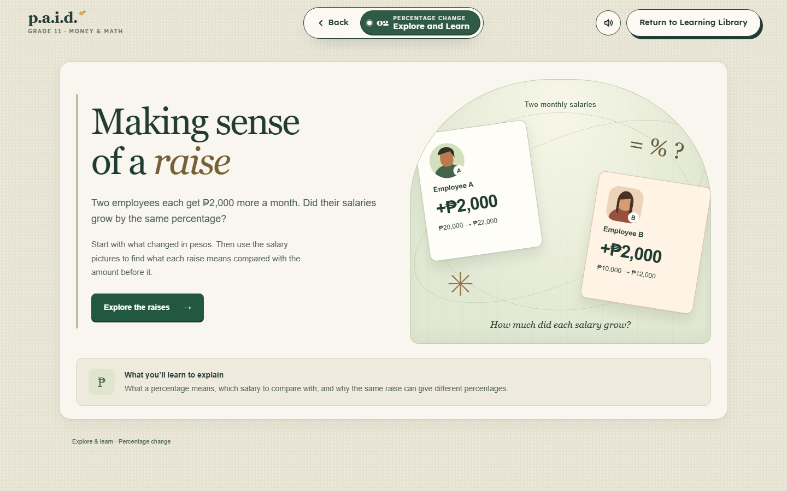
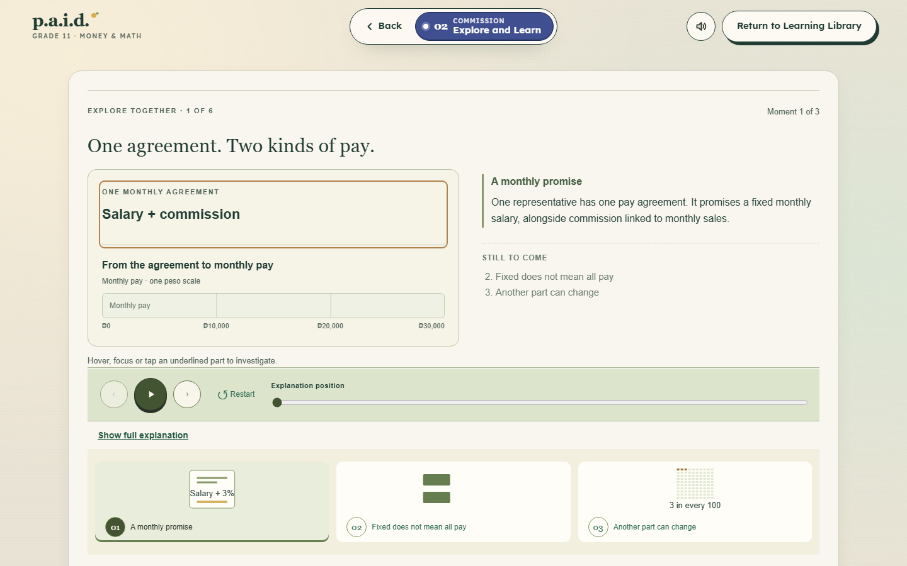
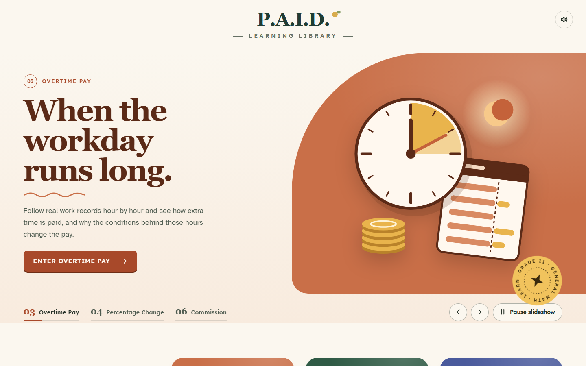

<p align="center">
  
</p>

<h1 align="center">P.A.I.D.</h1>

<p align="center"><strong>Interactive, offline mathematics lessons about earning a wage, for Grade 11 learners.</strong></p>

<p align="center">
  
</p>

P.A.I.D. teaches the mathematics behind a payslip: how overtime is paid, how a raise or price change is measured, and how commission turns sales into earnings. Learners work through short, story-based activities with interactive models and explain their reasoning as well as their answers. The app runs entirely on the device. It needs no account and no internet connection.

P.A.I.D. was developed as part of an educational research project. See [Research context and limitations](#research-context-and-limitations).

## What learners work through

P.A.I.D. currently offers three competencies:

| Competency | Focus |
|---|---|
| **Overtime Pay** | Hours beyond the regular workday, and how the kind of day (ordinary, rest day, regular holiday) changes the rate |
| **Percentage Change** | Increases and decreases, always measured from the original amount |
| **Commission** | How sales and rates become earnings, and how different pay agreements compare |

Each competency is a four-activity journey. The sequence is informed by the 7E instructional model:

1. **Prepare.** Share your first thinking about a realistic situation before any rule is given.
2. **Explore and Learn.** Build the idea step by step with an interactive model.
3. **Apply.** Calculate in a new situation and explain what the result means.
4. **Check and Transfer.** Carry the reasoning to an unfamiliar case.

<p align="center">
  
</p>

| Overtime Pay | Percentage Change | Commission |
|---|---|---|
|  |  |  |
| Two extra hours, on two kinds of day | The same raise, two different percentages | One agreement, two kinds of pay |

## Features

- **Works offline.** Everything runs on the device.
- **Exact arithmetic.** Money calculations use exact decimal arithmetic, not floating point.
- **Saves progress.** Work is saved as the learner goes and can be resumed after the app is closed.
- **Designed for phones and desktops.** Layouts are tuned for phone screens in both orientations.
- **Accessibility-minded.** Readable typefaces (Atkinson Hyperlegible, Lexend), screen-reader status announcements, and respect for the system's reduced-motion setting.
- **Optional sound.** Quiet interface sounds that can be switched off.
- **Android support.** Uses the hardware Back button and stores progress natively.

## Install on Android

Requirements: Android 7.0 (API level 24) or newer.

1. Download `PAID-vX.Y.Z.apk` from the [latest release](../../releases).
2. Optionally, check that its SHA-256 matches the checksum in the release notes.
3. Open the file and allow installation from that source when Android asks.

Release APKs are development-signed research builds and are not distributed through Google Play. See [docs/RELEASING.md](docs/RELEASING.md).

## Build from source

You need Node.js 24 and npm 11. Android builds also need JDK 21 and the Android SDK (platform 36).

```sh
git clone https://github.com/razor989/P.A.I.D-app.git
cd P.A.I.D-app
npm ci
npm run dev        # development server
npm run verify     # type check, lint, formatting, content check, unit tests
npm run build      # production web build in dist/
```

For the browser test suites and building the Android APK, see [docs/BUILDING.md](docs/BUILDING.md).

## How it is built

<p align="center">
  
</p>

React 19 and TypeScript, built with Vite. Activity and session logic are XState state machines. Content definitions are validated with Zod, and arithmetic uses bignumber.js. Capacitor 8 packages the same web build as an Android app. Lint rules enforce the boundaries between layers. The tests include about 1,600 Vitest unit and component tests and Playwright end-to-end, accessibility (axe-core) and phone-layout suites. See [docs/ARCHITECTURE.md](docs/ARCHITECTURE.md).

## Research context and limitations

- P.A.I.D. is a research instrument and learning resource. **Its effect on learning has not yet been evaluated.** Nothing here claims it improves learning outcomes.
- Accessibility was designed in and is checked by automated tests, but the app has **not been independently audited or certified**.
- The app's catalogue defines six competencies. Three are available to learners now. **Gross Income, Net Pay and Statutory Deductions, and Wage and Salary Representation and Conversion are not yet available.**
- Scenarios use Philippine pesos and Philippine wage concepts.

## License and credits

**No open-source licence is granted.** The source code and original assets are © the P.A.I.D. author, all rights reserved. They are published so the project can be read, reviewed and built. See [ASSETS.md](ASSETS.md) for third-party material and its terms.

Fonts: [Atkinson Hyperlegible](https://github.com/googlefonts/atkinson-hyperlegible) (Braille Institute of America), [Lexend](https://github.com/googlefonts/lexend) (The Lexend Project Authors) and [IBM Plex Mono](https://github.com/IBM/plex) (IBM Corp.), all under the SIL Open Font License 1.1.

Sound effects are processed from third-party libraries plus original synthesized cues. Sources are listed in [ASSETS.md](ASSETS.md). Thanks to [cicifyre](https://cicifyre.itch.io/) for the Free Natural SFX Pack.

## Project status

Version 1.0.0. The instructional experience for the three competencies above is complete, and the Android build has been tested on a physical device. The development history is summarized in [docs/PROJECT-HISTORY.md](docs/PROJECT-HISTORY.md), and changes are recorded in [CHANGELOG.md](CHANGELOG.md).
